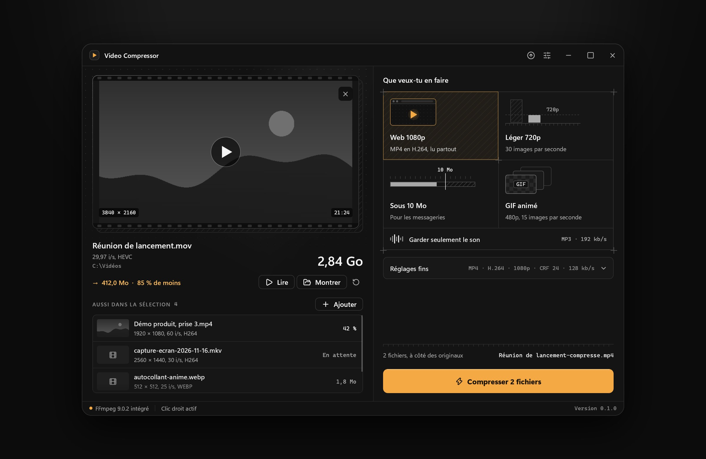

<p align="center">
  
</p>

# Video Compressor

Compresser ou convertir une vidéo d'un clic droit, sous Windows, Linux et macOS.

Le site du projet est sur [djdevpro.github.io/video-compressor](https://djdevpro.github.io/video-compressor/).

Un clic droit sur une vidéo ouvre une petite fenêtre avec le fichier déjà chargé. La vidéo est à gauche, ce qu'on veut en faire à droite. Un choix suffit la plupart du temps. Les réglages fins donnent la main sur le format, la résolution, le nombre d'images par seconde et le degré de compression. Le fichier produit arrive à côté de l'original, qui n'est jamais modifié.

L'application est écrite en Rust avec egui. FFmpeg est compilé dans l'exécutable. Il n'y a ni programme à installer à côté, ni fichier à télécharger au premier lancement.

## Ce qu'elle fait

- Elle écrit du MP4, du MKV, du MOV et du WebM, en H.264, H.265, AV1 ou VP9.
- Elle transforme une vidéo en GIF animé, en WebP animé, ou n'en garde que le son en MP3.
- Elle lit tout ce que FFmpeg lit, et aussi les WebP animés, que FFmpeg ne sait pas décoder. Un WebP animé devient un MP4 comme n'importe quelle vidéo.
- Elle règle la résolution de 240p à 4K et la cadence de 10 à 60 images par seconde, sans jamais agrandir ni inventer d'images.
- Elle compresse selon une qualité choisie sur un curseur, ou selon une taille à ne pas dépasser. Dans ce second cas, elle recommence avec un débit corrigé si le premier essai dépasse la limite.
- Elle redresse les vidéos de téléphone tenues debout.
- Elle lit la vidéo choisie dans son aperçu, avec pause et déplacement, sans le son.
- Elle traite plusieurs fichiers à la suite. Sélectionner dix vidéos puis faire un clic droit les réunit dans la même fenêtre.
- Elle propose cinq choix tout faits, Web 1080p, Léger 720p, Sous 10 Mo, GIF animé et le son seul.

## Installer

Les versions sont publiées sur la page [Releases](https://github.com/djdevpro/video-compressor/releases).

| Système | Fichier | Remarque |
| --- | --- | --- |
| Windows | `video-compressor-<version>-windows-x64.exe` | Un seul exécutable, sans installation |
| Linux | `video-compressor-<version>-linux-x64` | À rendre exécutable avec `chmod +x` |
| macOS | `video-compressor-<version>-macos-universal.zip` | Contient `Video Compressor.app`, pour les puces Apple et Intel |

Au premier lancement, la fenêtre propose d'ajouter son entrée au clic droit des vidéos.

## Le clic droit

L'entrée « Compresser avec Video Compressor » s'active dans la fenêtre ou dans les préférences, sans droit d'administrateur. Elle se retire au même endroit.

| Système | Ce que l'application pose | Où trouver l'entrée |
| --- | --- | --- |
| Windows | Une commande par extension vidéo dans le registre de l'utilisateur | Sous Windows 11, dans « Afficher d'autres options », ou avec Maj et clic droit |
| Linux | Une entrée d'application, un script Nautilus, une action Nemo et un menu de service Dolphin | Dans Fichiers sous Scripts, dans Nemo et Dolphin, et dans « Ouvrir avec » |
| macOS | Une action rapide du Finder | Dans le clic droit, sous Actions rapides ou Services |

Sous Windows et Linux, l'application se copie d'abord à un endroit stable, `%LOCALAPPDATA%\Programs\Video Compressor` ou `~/.local/bin`. Le clic droit marche donc encore si le fichier téléchargé est déplacé.

## Les mises à jour

Au démarrage, l'application pose une seule question à GitHub pour savoir si une version plus récente est publiée. Si oui, un point apparaît sur le bouton de mise à jour. La fenêtre montre alors les nouveautés, télécharge le fichier, vérifie son empreinte SHA-256, remplace l'exécutable et redémarre.

La vérification automatique et le canal bêta se règlent dans les préférences.

## Compiler

Il faut Rust stable, un compilateur C et C++ (Visual Studio sous Windows) et libclang. Sous Linux et macOS, il faut aussi nasm, pkg-config, autoconf, automake et libtool, et sous Linux les bibliothèques de fenêtrage listées dans [ci.yml](.github/workflows/ci.yml).

FFmpeg est lié statiquement. Ses bibliothèques se compilent une fois, avec vcpkg, à partir de [vcpkg.json](vcpkg.json). Le script les range dans `vcpkg_installed/current`, où cargo les attend. Compter dix à vingt minutes la première fois. Sous Windows, le script se lance depuis Git Bash et trouve le vcpkg de Visual Studio.

```bash
bash scripts/ffmpeg-libs.sh
```

Ensuite, les commandes habituelles suffisent.

```bash
cargo run
```

```bash
cargo test
```

Les tests couvrent le moteur, l'interface sans écran, et de vrais encodages. Ils fabriquent une mire avec les filtres de FFmpeg, l'encodent dans chaque format, puis relisent le fichier produit. Le test `captures` écrit des images de l'interface dans `target/captures`.

## Publier une version

Le workflow [Release](.github/workflows/release.yml) se lance à la main depuis l'onglet Actions. Il calcule le numéro de version à partir du dernier tag, compile les bibliothèques de FFmpeg si elles ne sont pas en cache, lance tous les tests sur les trois systèmes, construit les binaires, vérifie qu'ils démarrent, puis publie la release avec ses empreintes. Les applications déjà installées la proposent à leur prochain démarrage.

## Organisation du code

| Fichier | Rôle |
| --- | --- |
| `src/app.rs`, `src/dialogs.rs` | La fenêtre, ses actions, les préférences et la mise à jour |
| `src/theme.rs`, `src/widgets.rs`, `src/icons.rs` | L'apparence et les widgets, repris de [Rust Project](https://github.com/djdevpro/rustproject) |
| `src/draw.rs` | Les motifs de l'écran, trame, hachures, pellicule, et les dessins des choix |
| `src/settings.rs` | Les réglages d'encodage, les choix tout faits et les préférences |
| `src/engine.rs` | Le moteur vidéo, sur FFmpeg lié dans l'exécutable par la crate `ffmpeg-next` |
| `src/webp.rs` | Le décodage des WebP animés |
| `src/queue.rs` | La file des fichiers et ses fils de travail |
| `src/player.rs` | Le lecteur de l'aperçu |
| `src/shell.rs` | L'entrée du clic droit sur chaque système |
| `src/instance.rs` | Une seule fenêtre, même lancée dix fois |
| `src/release.rs`, `src/net.rs` | La mise à jour de l'application |
| `src/i18n.rs`, `locales/en.json` | Le français du code et sa traduction anglaise |
| `build.rs`, `vcpkg.json`, `scripts/ffmpeg-libs.sh` | La compilation et l'édition de liens de FFmpeg |
| `landing/`, `scripts/landing-shots.py` | Le site du projet et ses images, tirées des captures de l'application |

## Licence

Le code de Video Compressor est sous licence MIT ou Apache 2.0, au choix.

Les exécutables publiés contiennent FFmpeg et les encodeurs x264 et x265, liés statiquement. Ils sont donc distribués sous licence GPL version 3. Les sources de tout ce qu'ils contiennent sont publiques, ce dépôt pour l'application, [ffmpeg.org](https://ffmpeg.org/download.html) et [vcpkg](https://github.com/microsoft/vcpkg) pour FFmpeg et ses bibliothèques, aux versions fixées par `vcpkg.json`.
